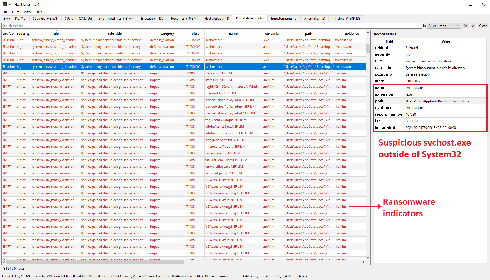
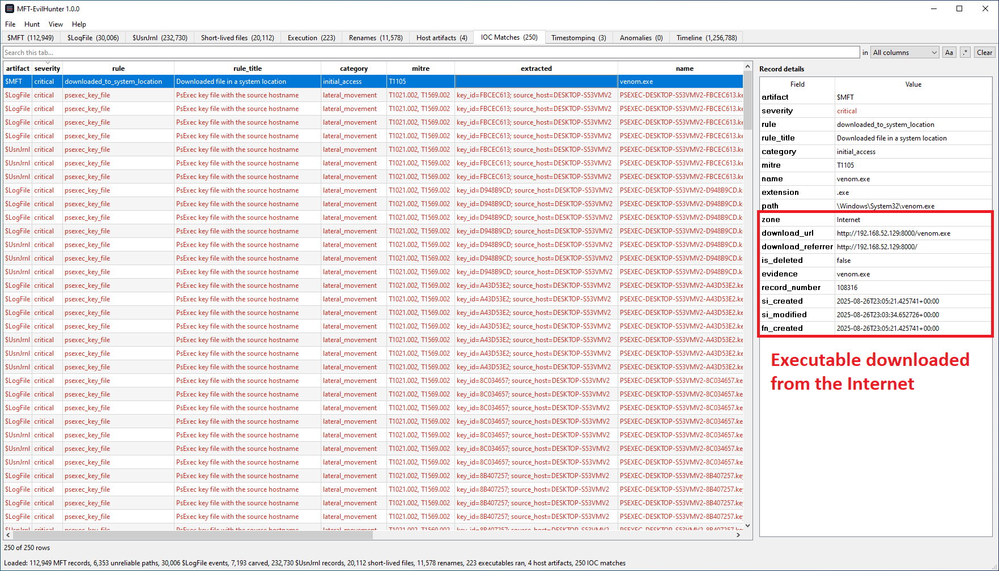
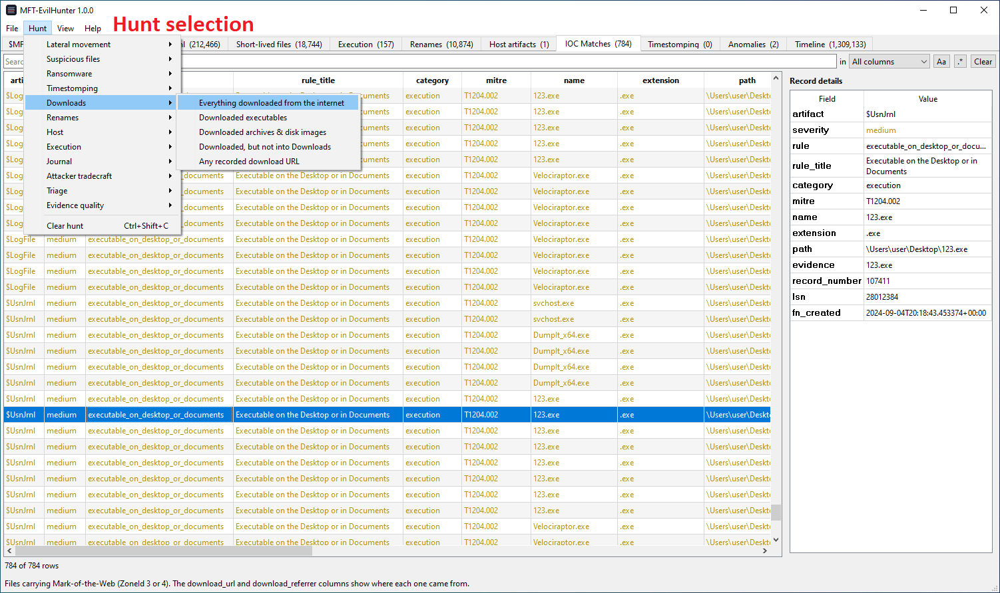
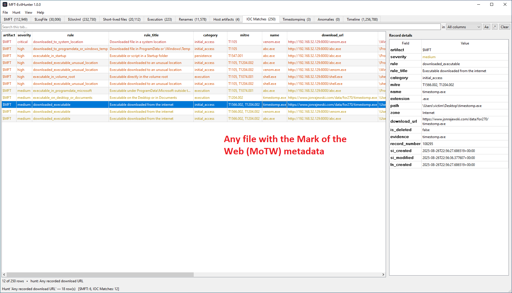

# MFT-EvilHunter

`MFT-EvilHunter` is a tool for hunting indicators of compromise in NTFS metadata. It parses `$MFT`, `$LogFile` and `$UsnJrnl:$J`, runs a rule pack and a set of heuristics over every record, and presents the results in searchable tables that can be exported to CSV format.



## Features

- Loads and parses `$MFT`, `$LogFile` and `$UsnJrnl:$J`.
- Rule pack of 70+ rules mapped to MITRE ATT&CK.
- Detection of timestomping, masquerading and typosquatted system binaries, mass extension change for ransomware families, ransom note fan-out, resident content that disagrees with the extension.
- Journal correlation: files created and deleted within seconds, rename chains that end on a system binary name or turn a document into an executable.
- Evidence of execution reconstructed from Prefetch file names, with a LOLBin watchlist.
- Detection of cleared event logs, new user profiles and outbound RDP inferred from `$MFT` metadata.
- Multiple hunts, per-tab search with column filter and regex, attack window applied at parse time, combined MACB timeline.
- Custom rule packs in JSON and plain IOC lists.
- CSV export of any tab, filters and hunt included.





## Requirements

- Python 3.9+
- `PySide6` (GUI), see `requirements.txt`. `PyQt6` works as well.

```
pip install -r requirements.txt
```

## Usage

Launch the GUI:

```
python3 mft-evilhunter.py
```

Then use **File -> Open evidence…**, pick the `$MFT` and optionally `$J` and `$LogFile`, and choose the analysis options. Paths given on the command line prefill the dialog, in the order `$MFT`, `$J`, `$LogFile`:

```
python3 mft-evilhunter.py '$MFT' '$J' '$LogFile'
```

Once loaded, every artifact has its own tab. Start with **Hunt -> Lateral movement -> PsExec & clones** or **Hunt -> Triage -> Critical & high severity only**, then narrow with the search bar. The details panel shows every field of the selected row, including values a rule extracted such as the PsExec source hostname or a download URL.

To add your own indicators, put a JSON rule pack (see `examples/custom-rules.json`) or a plain text IOC list with one file name, path or `/regex/` per line (see `examples/ioc-list.txt`) in the **IOC rules** box.

Setting an attack window in the open dialog keeps only rows inside that time range, which cuts memory and load time on large volumes. Paths marked unreliable depend on a reused or missing parent record; check `path_source` before quoting them in a report.

## Building executables

```
./build.sh      # Linux    --> dist/mft-evilhunter
build.bat       # Windows  --> dist\mft-evilhunter.exe
```

`build.bat` looks for Python 3.12 and installs it for the current user from python.org if it is not found, then builds in a throwaway virtualenv and removes it.

## Project structure

```
mft-evilhunter.py           # thin launcher (python3 mft-evilhunter.py)
build.sh / build.bat        # single-file executable builds
requirements.txt
examples/                   # sample custom rule pack and IOC list
mft_evilhunter/
  ntfs.py                   # binary primitives, fixup, FILETIME, $SI and $FN decoding
  mft.py                    # $MFT parsing, path reconstruction, Zone.Identifier
  logfile.py                # $LogFile page walking, opcode decoding and carving
  usnjrnl.py                # $UsnJrnl:$J records, lifetime and rename correlation
  ioc.py                    # rule engine
  rules/default.json        # bundled rule pack
  detect.py                 # timestomping, masquerading, mass extension change
  baseline.py               # per-volume install epochs
  execution.py              # Prefetch-derived execution evidence, LOLBin watchlist
  hostartifacts.py          # event logs, user profiles, RDP client evidence
  filetypes.py              # extension sets, content signatures, system binary map
  paths.py                  # path normalisation and noise filtering
  report.py                 # CSV writing, MACB timeline rows
  gui/
    app.py                  # application entry point
    mainwindow.py           # menus, hunt wiring, worker lifecycle
    opendialog.py           # open dialog and the memory estimate
    tabs.py                 # search bar, table, details panel, export
    models.py               # table model with filtering and sorting
    dataset.py              # tab data construction, attack window
    hunts.py                # hunt menu predicates
    timerange.py            # attack window fields
    workers.py              # background parsing thread
    qt.py                   # PySide6 / PyQt6 shim
    icons.py                # icon loading
    assets/                 # icon.png / icon.ico
```

## License

This project is licensed under the MIT License. See [LICENSE](LICENSE) for details.
